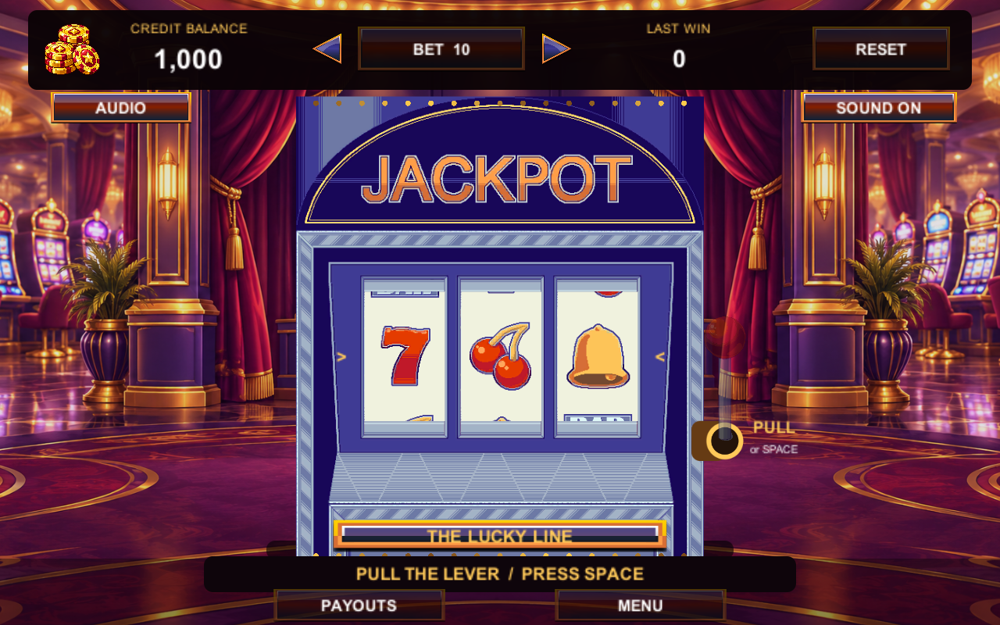
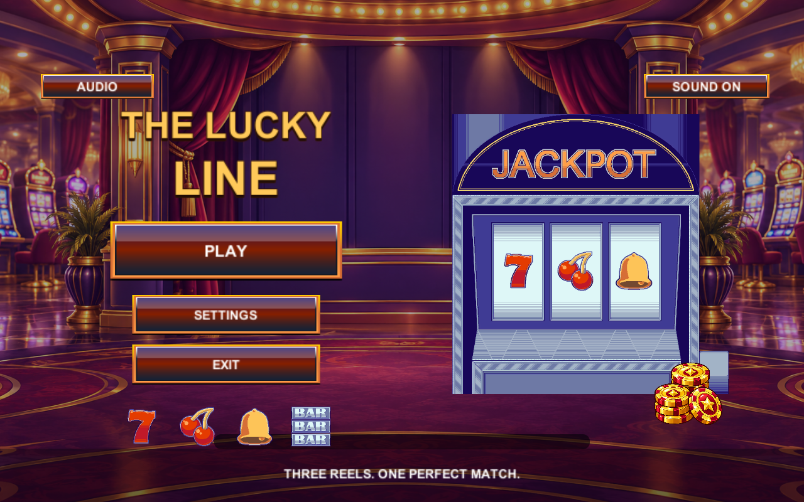
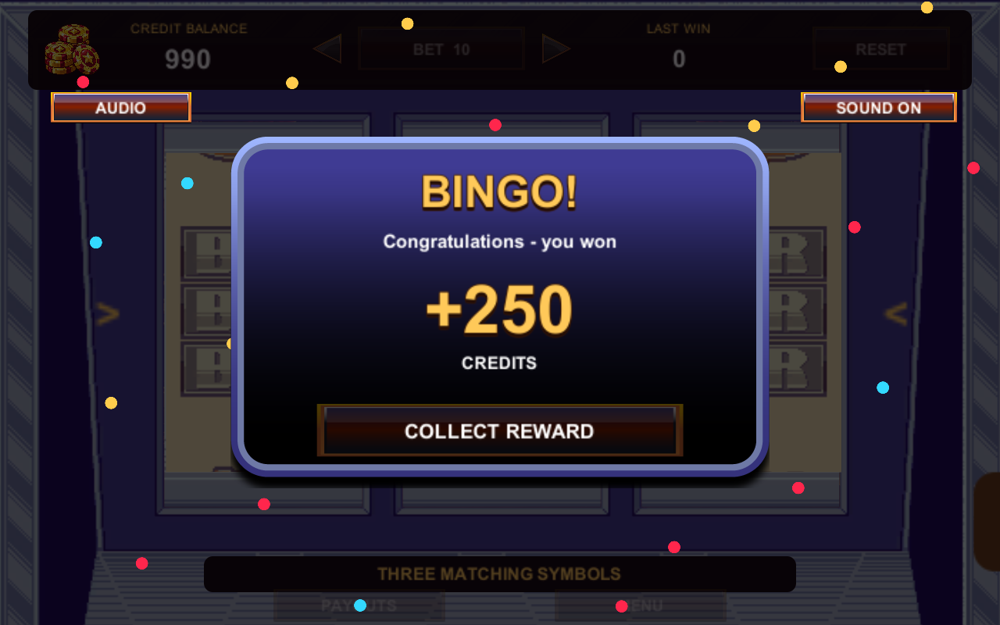

# The Lucky Line

A playable Unity slot-machine internship assignment with a classic red-and-gold 2.5D casino presentation. Built with **Unity 6000.6.7f1**. The complete editable project and WebGL build are included.



## Play the included WebGL build

Clone the repository. From its root, serve the build over HTTP:

```sh
python -m http.server 8080 --directory Build/WebGL
```

Open http://localhost:8080 in a desktop browser. Do not open index.html directly as a local file. Web output is uncompressed so a simple HTTP server works without custom compression headers. Browser audio begins after an interaction.

## Controls and flow

- **PLAY** enters the standing view. The attached red lever or **Space** starts a spin. There is no separate SPIN button.
- The camera presentation zooms into the live reels. Symbols stop left to right, each with its own settling animation and musical pop.
- Three identical central symbols show **BINGO** and a payout count-up. **COLLECT REWARD** transfers the win to the balance, animates coins, then returns to the cabinet.
- A non-matching result displays **NO MATCH** and returns automatically after a short pause.
- The top bar contains a casino-chip credit icon, the current balance, selected bet, last win and **RESET**. Reset asks for confirmation and is unavailable during an unresolved round.
- **PAYOUTS** explains the rules. **MENU** returns to the title between rounds.
- **AUDIO/SETTINGS** offers master volume and reduced motion. **SOUND ON/OFF** mutes every effect. There are no spoken voice cues.
- **EXIT** in WebGL shows a finished-session panel with a return-to-menu option; it does not close the browser.



## Rules and payouts

Start with **1,000 simulated credits**. Bets are **10, 25, and 50**, defaulting to 10. Three reels use the four supplied symbols with equal, independent probability. Only three identical centre symbols win.

| Symbol | Total payout |
|---|---:|
| Seven (`slot-symbol1`) | 5 x bet |
| Cherries (`slot-symbol2`) | 10 x bet |
| Bell (`slot-symbol3`) | 20 x bet |
| BAR (`slot-symbol4`) | 25 x bet |

The bet is deducted once when the lever pull is accepted. Payout means the total credits awarded on collection. Each exact outcome has probability 1/64; four outcomes win. The mathematical long-run credit return is 60/64, or 93.75%, without any guarantee for an individual session. This is a simulation with no real-money transactions.



## Open and rebuild in Unity

Install Unity **6000.6.7f1** with **Web Build Support**, add this folder through Unity Hub, open `Assets/Scenes/Main.unity`, and press Play.

The Unity Editor command-line executable supports these entrypoints:

- `ProjectBuilder.BuildWeb`: checks core logic and exports `Build/WebGL`, including responsive page styling.
- `ProjectBuilder.BuildWebPlayer`: exports the WebGL player without running the logic checks, while still checking supplied scene assets.
- `ProjectBuilder.VerifyLogic`: runs exhaustive outcome and persistent-round checks.
- `RuntimeVerification.Run`: enters Play Mode, tests the complete flow and captures review images; it exits with success or failure. Do **not** pass `-quit` for this entrypoint.
- `ProjectBuilder.Create`: regenerates the editable scene, prefabs and default configuration. This deliberately replaces manual changes to the generated scene/configuration.
- `ProjectBuilder.CreateAndVerify`: regenerates, then runs Play Mode verification.

Example PowerShell build command, replacing the project path as needed:

```powershell
& 'C:\Program Files\Unity\Hub\Editor\6000.6.7f1\Editor\Unity.exe' -batchmode -quit -projectPath 'C:\path\to\unity-slot-game-assignment' -executeMethod ProjectBuilder.BuildWeb -buildTarget WebGL -logFile build.log
```

## Approach and code structure

`RoundSession` owns accounting and pending-round persistence. `OutcomeGenerator` and `PayoutEvaluator` are independent of UI and accept a deterministic random source in tests. `SlotController` coordinates explicit menu/entry/pull/zoom/spin/result/collect/return states. `CabinetView`, `CasinoEffects`, `ButtonMotion` and `GameAudio` handle presentation separately.

`GameConfig` contains symbols, stakes and multipliers. `Presentation` exposes timing for zoom, lever pull, staggered stops, count-up and collection. Transitions use shared cubic ease-in/out/in-out functions, with back-ease-out for the reward card. The actual cabinet, lever, reels and lights share a hierarchy, so zoom retains their physical connection.

The supplied left/right arrows decrease/increase the bet, and supplied circular X controls close panels.

Source folders separate Scripts, Prefabs, Animations, UI, Sounds, Scenes and Editor tooling. Animations are implemented as reusable coroutines; no external tweening plugin is required. Unity metadata, Packages and ProjectSettings are tracked; Library and other generated caches are ignored.

See [maintaining the project](Docs/maintaining-project.md) for the main human-editable settings, source files and folders. C# uses the repository `.editorconfig`.

## Saves and interrupted rounds

One local JSON record contains the deducted balance, selected symbols, stake and pending reward. Reloading cannot reroll a saved round or charge it again. Press PLAY after a reload to resume its result screen. An uncollected winning payout remains pending until COLLECT.

Collection saves the increased balance and clears the pending round **before** the coin animation starts, so repeated input or a reload cannot award it twice. Existing version-1 saves migrate while preserving valid balance, bet and mute settings. Invalid saves fall back to defaults; malformed pending records are discarded while preserving a valid balance. Saves are local to the browser and origin; clearing site storage removes them.

## Presentation extras

Centered cabinet and attached animated lever; eased menu/button/zoom transitions; subtle parallax; animated marquee bulbs; sequential symbol pops and highlights; side colour sweeps; red BINGO card; confetti; payout count-up; explicit collect-and-coin animation; confirmed reset; volume/mute and reduced motion. Reduced motion uses short fades instead of zoom/bounce and disables confetti. Effects cannot change outcomes or payouts.

## Assets and attribution

Machine artwork, symbol textures, background and source controls are from the supplied **Slot Machine** assignment archive: https://drive.google.com/file/d/1LA8Ma42PWi1sz8xlvIsbpHQfNSLwSamF/view . The archive includes artwork and a reference GIF, but no separate design document. The three-reel rules, bets, starting credits and payout values are explicit project assumptions.

Every one of the 16 supplied PNGs is referenced by the scene, including the original glossy button panel, popup frame, arrow/close interaction states, YES/NO sheet, reel backing and lever parts. The 85-frame GIF is used as a motion reference. See [provided asset map](Docs/provided-asset-use.md). All 17 original files remain byte-for-byte unchanged. The supplementary casino-token HUD icon was generated with the built-in ImageGen tool using the user-provided coin-stack image as a style reference; see [asset prompt](Docs/casino-coins-prompt.md). The cabinet, lever, menu hero and sprite-sheet controls reference cropped regions of the supplied artwork. The casino-room illustration is an additional background behind those original assets; see [background generation prompt](Docs/casino-room-prompt.md). Coin rattles, mechanical cues and musical stingers are mixed from Kenney Casino Audio, Interface Sounds and Music Jingles (CC0). Source licenses and selected originals are included under `Assets/Sounds/Kenney`; `Tools/build_audio.py` rebuilds the WAVs. See [sound-design references and implementation](Docs/audio-design.md). No speech, paid assets or paid plugins are used. Source artwork remains subject to its original owner's terms; no new ownership claim is made.

## Validation

See [verification results](Docs/verification.md) for automated checks, Edge tests and limitations. Runtime captures and scratch logs are generated in the ignored `Artifacts` directory. Preview images above are captured from the actual Unity scene.
