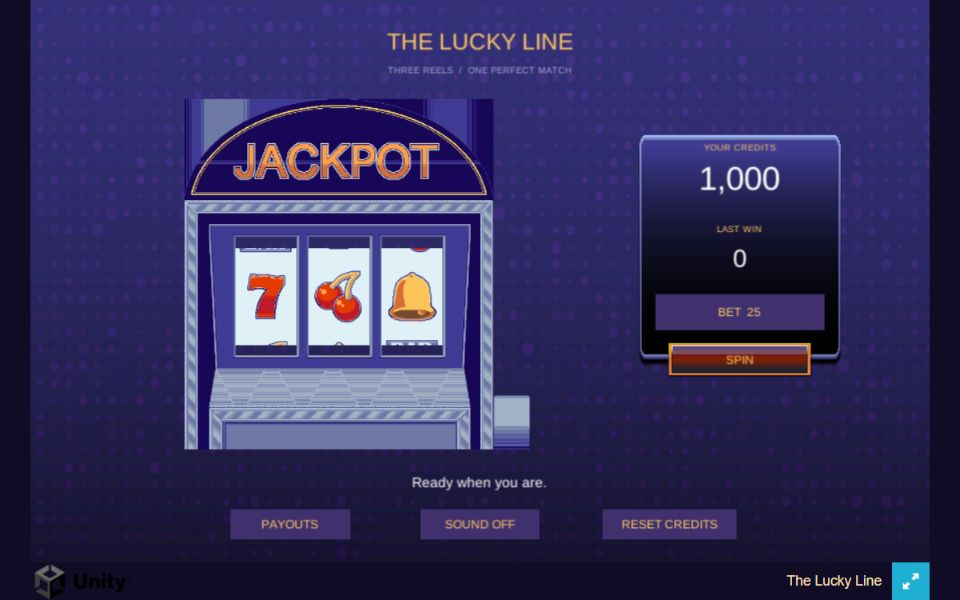
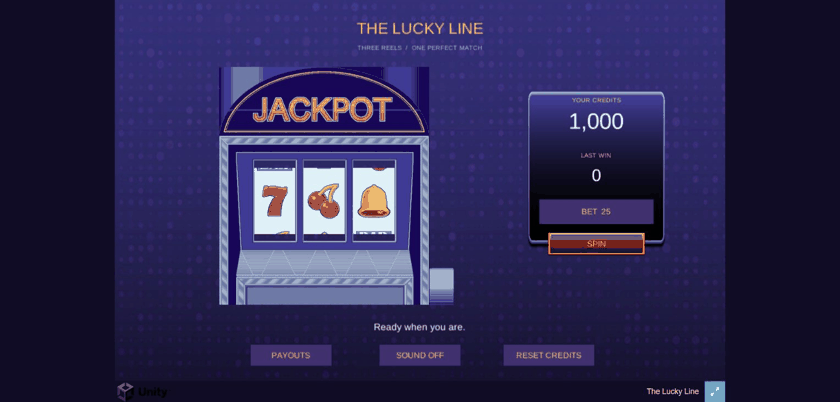

# The Lucky Line

Unity slot-machine internship assignment, using Unity 6000.6.7f1.

## Animation preview
Recorded from the actual WebGL game running in Edge.

## Gameplay
Three reels, four equally likely symbols, one central winning line. Three identical centre symbols win. Start with 1,000 credits; cycle between bets of 10, 25 and 50. Seven pays 5 times the bet, cherries 10, bell 20, and BAR 25. Payout means the total amount credited after the stake has been deducted.

## Controls
SPIN starts a round. BET cycles stakes. PAYOUTS explains the rules. SOUND toggles audio. RESET CREDITS asks for confirmation before replacing the balance with 1,000. Controls prevent overlapping spins or bet changes during a round.

## Development
Open Assets/Scenes/Main.unity in Unity 6000.6.7f1. Web Build Support is required for browser export. ProjectBuilder.Create generates the editable scene and reusable prefabs; ProjectBuilder.VerifyLogic checks all 64 outcomes and basic wallet accounting; ProjectBuilder.BuildWeb exports to Build/WebGL. Invoke these static methods with Unity Editor's batch-mode executeMethod argument.

## Design
Outcome generation, payout evaluation and wallet arithmetic are independent of presentation. Reels reveal results chosen before animation. Configuration holds symbols, stakes, multipliers and timing. Credits are saved after stake deduction and settlement. Reloading during an unfinished spin forfeits that stake; it cannot refund or replay the round. Invalid saves fall back to defaults. Browser storage is local to its origin.

## Assets and extras
Artwork comes from the supplied Slot Machine assignment archive. Audio tones are generated for this project. Polish includes staggered stops, win highlights, sound/mute, payout help, saved credits and confirmed reset. No paid plugins are used.

## Running the browser build
Serve the repository's Build/WebGL directory with a local HTTP server. For example, from the repository root, run `python -m http.server 8080 --directory Build/WebGL`, then visit http://localhost:8080. Opening index.html directly as a local file is unsupported. Audio requires browser interaction.

## Command-line builds
Run the installed Unity Editor executable with `-batchmode -quit -projectPath` followed by this project's absolute path, then `-executeMethod ProjectBuilder.BuildWeb -buildTarget WebGL -logFile build.log`. The build method fails if Unity reports an unsuccessful build. Web output is uncompressed for straightforward local serving.

## Verification
`ProjectBuilder.VerifyLogic` checks every one of the 64 possible outcomes, requiring exactly four wins and the configured payout for each, plus stake deduction and wallet accounting.

`RuntimeVerification.Run` enters Play Mode and checks repeated-click protection, bet locking, saved stakes, exact settlement, reel landing, mute persistence, reset/cancel, saved bets, corrupt-save recovery and insufficient credits. Run it in batch mode with `-executeMethod RuntimeVerification.Run`, without `-quit`; it exits with a success or failure code. It preserves the existing local save and restores it after the run. The test uses a deterministic random source only inside the Editor test; production spins use the normal random source.

Verification images and the report are written into the ignored Artifacts folder. These tests passed in Unity 6000.6.7f1. Initial Edge browser smoke tests passed: loading, losing spin accounting, saved balance/bet/mute, payout help, reset cancel/confirm, and reload during a spin. No console errors were observed; Unity reports a storage-sync deprecation warning. The current-source WebGL build succeeded. Edge resizing passed at 960x600 and 1280x800 with all controls visible and no page overflow. The generated page maintains a 16:10 canvas and opts into automatic persistent-storage synchronization.

## Assumptions
The provided archive contains artwork and a reference GIF but no separate design document. Three reels, the bet values, starting balance and payout multipliers are project decisions documented above. Each exact result has probability 1/64. The four winning multipliers total 60, giving a theoretical 93.75% credit return over many spins. This does not guarantee a return during any individual session.

## Delivery
The repository includes the complete editable Unity project and the browser build in `Build/WebGL`. Generated Unity caches are excluded. See the verification section for tested behavior and the recorded limits of testing. Visual adjustments can be made in `Assets/Scenes/Main.unity` or regenerated through `ProjectBuilder.Create`.
